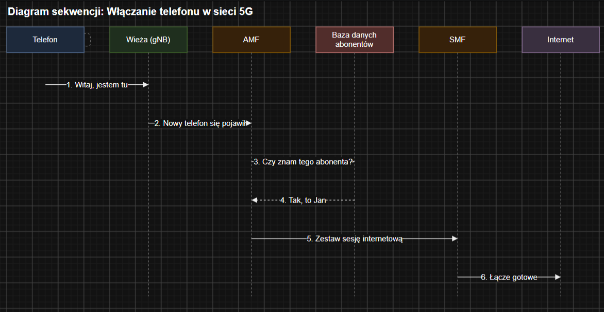

# Dziennik Laboratorium - Architektura Systemów Telekomunikacyjnych

**Autor:** Mehmet Emin Aydın  
**Numer indeksu:** 74011  
**Tryb pracy:** Indywidualny (Projekt jednoosobowy)

---

## Temat 1: Rdzeń sieci 5G jako chmura funkcji (SBA)

### 1. Lista komunikatów (scenariusz "włączanie telefonu")

1. Telefon → Wieża (gNB): "Witaj, jestem tu"
2. Wieża (gNB) → AMF: "Nowy telefon się pojawił"
3. AMF → Baza danych abonentów: "Czy znam tego abonenta?"
4. Baza danych abonentów → AMF: "Tak, to Jan"
5. AMF → SMF: "Zestaw sesję internetową"
6. SMF → Internet: "Łącze gotowe"

---

### 2. Odpowiedzi na pytania teoretyczne

#### a) Czym różni się sygnalizacja od ruchu użytkownika?
Sygnalizacja to komunikaty sterujące. One mówią sieci, co ma zrobić (np. włącz telefon, zrób sesję). To nie są dane użytkownika.  
Ruch użytkownika to prawdziwe dane, które chcemy wysłać lub odebrać (np. strony WWW, filmy na YouTube, zdjęcia).

**Krótko:** Sygnalizacja przygotowuje połączenie, a ruch użytkownika to dane przesyłane po połączeniu.

#### b) Co robi funkcja AMF?
AMF (Access and Mobility Management Function) zarządza dostępem do sieci. Kiedy telefon się włącza, AMF pyta bazę danych, czy zna tego użytkownika i pozwala mu wejść do sieci. AMF pamięta też, gdzie jest telefon, gdy się przemieszcza.

**Krótko:** AMF sprawdza telefon, rejestruje go i dba o jego mobilność.

#### c) Co oznacza skrót SBA?
SBA to Service-Based Architecture (architektura oparta na usługach). W 5G rdzeń sieci składa się z małych funkcji (AMF, SMF), które rozmawiają ze sobą przez API. Całość działa elastycznie, podobnie jak chmura.

**Krótko:** SBA to budowanie rdzenia sieci z małych, współpracujących usług.

---

### 3. Podział pracy (Projekt indywidualny)

Projekt wykonuję samodzielnie, więc odpowiadam za wszystkie zadania:
- **Symulator i scenariusze:** Mehmet Emin Aydın (74011)
- **Diagram sekwencji (draw.io):** Mehmet Emin Aydın (74011)
- **Dokumentacja (dziennik.md):** Mehmet Emin Aydın (74011)
- **Prezentacja:** Mehmet Emin Aydın (74011)

---

### 4. Wynik dnia

- Diagram sekwencji "Włączanie telefonu w 5G":

- Dziennik laboratoryjny (plik `dziennik.md`)